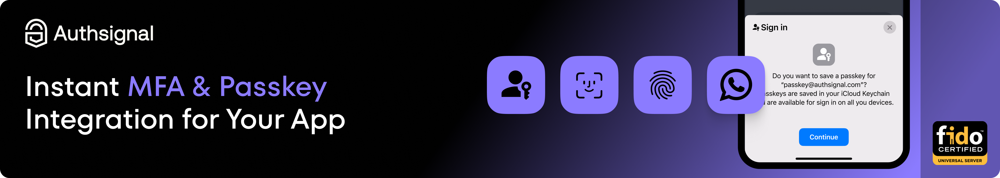

# Authsignal .NET MAUI SDK

Check out our [official Mobile SDK documentation](https://docs.authsignal.com/sdks/client/mobile/setup).

## Installation

Add the Authsignal .NET MAUI SDK to your project:

```bash
dotnet add package Authsignal.Maui
```

The SDK supports .NET 10 apps targeting iOS 13 and Android API 23 or newer.

## Initialization

Register the Authsignal client in `MauiProgram.cs`:

```csharp
using Authsignal.Maui;

builder.UseAuthsignal(options =>
{
    options.TenantId = "YOUR_TENANT_ID";
    options.BaseUrl = "YOUR_REGION_BASE_URL";
});
```

Then inject `IAuthsignalClient` where you need it. You can also create a client directly:

```csharp
var authsignal = new AuthsignalClient("YOUR_TENANT_ID", "YOUR_REGION_BASE_URL");
```

You can find your tenant ID in the [Authsignal Portal](https://portal.authsignal.com/organisations/tenants/api).

You must specify the correct base URL for your tenant's region.

| Region        | Base URL                         |
| ------------- | -------------------------------- |
| US (Oregon)   | https://api.authsignal.com/v1    |
| AU (Sydney)   | https://au.api.authsignal.com/v1 |
| EU (Dublin)   | https://eu.api.authsignal.com/v1 |
| CA (Montreal) | https://ca.api.authsignal.com/v1 |

## Usage

### Passkeys

For more detailed info on how to add passkeys to your app using Authsignal, check out our [passkey documentation for Mobile SDKs](https://docs.authsignal.com/authentication-methods/passkey/mobile-sdks).

### App verification

To see how to add app verification with push notifications or QR codes, see our [app verification documentation for Mobile SDKs](https://docs.authsignal.com/authentication-methods/app-verification/push).

### Requiring user authentication

`AddCredentialAsync` on `Push`, `Qr` and `InApp` takes `requireUserAuthentication`. When it's `true`, the device key can only sign after the user authenticates with biometrics or the device passcode.

- **iOS:** the system shows the Face ID / Touch ID / passcode prompt each time the key signs.
- **Android:** the SDK doesn't show a prompt. The key can sign for `TimeoutSeconds` after the user last authenticated, so show a `BiometricPrompt` in your app (or ask the user to unlock their device) right before you call a method that signs with the key: `InApp.VerifyAsync`, `Push.GetChallengeAsync`, `Push.UpdateChallengeAsync`, `Qr.ClaimChallengeAsync`, `Qr.UpdateChallengeAsync`, `Push.UpdateCredentialAsync`, or `RemoveCredentialAsync`. Requires Android 11 (API 30) or newer; older versions return `user_authentication_not_supported`.

```csharp
await authsignal.InApp.AddCredentialAsync(
    requireUserAuthentication: true,
    androidUserAuthentication: new AndroidUserAuthentication
    {
        TimeoutSeconds = 15, // default
        Authenticators = AndroidAuthenticators.BiometricStrong | AndroidAuthenticators.DeviceCredential, // default
    });
```

`androidUserAuthentication` is ignored on iOS and when `requireUserAuthentication` is `false`.

## License

This project is licensed under the MIT License - see the [LICENSE](LICENSE) file for details.
